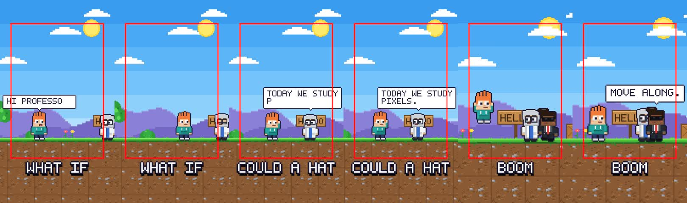
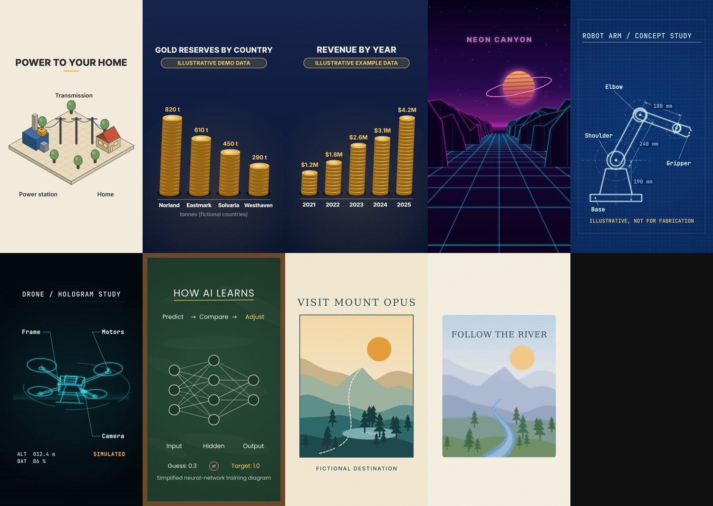
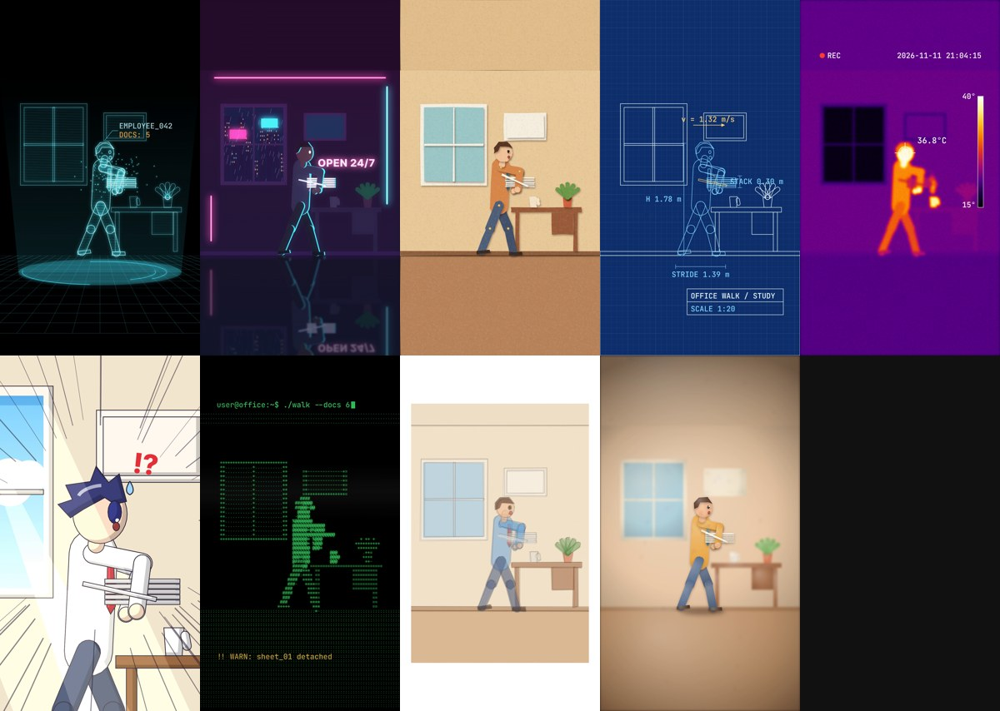

# claude-skill-for-video

Fifteen [Claude Code](https://claude.com/claude-code) skills that make animated reels with no footage. Describe the idea, Claude writes a small spec, and the video is rendered on your own computer.

| Skill | What it makes |
|---|---|
| `/cartoon-3d` | A 3D cartoon "what if" explainer (three.js): cartoon people, props, slow-motion impacts |
| `/stick-figure` | A bright stick-figure explainer with captions, whip transitions and sound effects |
| `/pixel-world` | A 2D pixel-art world with chunky outlined characters, speech bubbles, pixel transitions and **171 pixel effects** (fire, explosions, lightning, weather, pickups, magic). Two art styles: **Alex's Claude Pixel World** (original) and **Growtopia** (the game's block-head avatars with a configurable look) |
| `/isometric` | An isometric source-to-home diagram: power station, cables, pulses, a house lighting up |
| `/coin-chart` | A bar chart of stacked 3D gold coins on navy (marks made-up numbers as illustrative) |
| `/neon-flight` |  A looping synthwave flight through a neon wireframe canyon toward a ringed planet |
| `/blueprint` | A dimensioned robot-arm blueprint that traces itself on a cyan grid |
| `/hologram-hud` |  A holographic wireframe drone with HUD arcs, scan lines and callouts |
| `/chalkboard` |  A chalk neural-network diagram: predict, compare, adjust |
| `/poster` |  An illustrated landscape poster, travel or watercolour look |
| `/looks` |  One character scene (a worker, a stack of papers, a slipping sheet) in 9 styles: hologram, cyberpunk, paper cutout, blueprint, thermal, anime, ASCII, watercolour, claymation |
| `/minimalistic-graphics` | Black-and-white line-art animation |
| `/map-route` | A 3D map with an animated route |
| `/breakdown` | A 3D exploded view: a phone comes apart into 9 layers, then the view orbits around it, every part labelled |
| `/graph` | A minimal animated line graph |







## Install
```bash
git clone https://github.com/alexlukman/claude-skill-for-video
cd claude-skill-for-video
bash install.sh
```
`install.sh` links each skill into `~/.claude/skills/` and installs the render kit (three.js, GSAP, Playwright, all pinned in `kit/package-lock.json`). You need Node, Python 3 and ffmpeg, plus Chrome or Chromium (set `CHROME=/path/to/chrome` if needed). Then in Claude Code, run for example `/pixel-world`.

## How the new skills work
The 2D scene skills share `kit/scene2d/`: a canvas page, helpers (`lib.js`), a Playwright renderer and a builder. Each skill is a `scene.js` with a `renderAt(t)` that depends only on time, a `build.py` with defaults and checks, and a `SKILL.md`. Every one renders 1080x1920, 30 fps, 6 s, H.264 yuv420p, and `build.py <spec> --check` writes stills at 0, 1, 3, 5 and 5.9 s and warns about text that does not fit. Any of them can also take `"filter": "ascii" | "thermal" | "crt"` to post-process every frame.

## Other screen sizes
Everything renders as 9:16 first. Add `"size": "1920x1080"` (or `"16:9"`, `"1:1"`, `"4:5"`, any WIDTHxHEIGHT) to a spec to fit the video into that frame, with the sides filled by a blurred copy (`"fill": "blur"`) or a colour, and an optional `"zoom"` to enlarge it. For any finished video: `python3 kit/resize.py video.mp4 --size 16:9`.

## What changed from the original
This project started from [claude-animation-skills](https://github.com/artemnovitckii/claude-animation-skills) by Artem Novitckii (MIT). Changes:
- **`/cartoon-3d`** (was `/zach-d-films`): the faces no longer wobble. The head is one smooth surface, features are placed on it by ray-casting, the jaw stays still and the mouth only opens and closes.
- **`/breakdown`**: 9 layers instead of 6, and after the parts separate the view turns around the stack, with label dots tracking each part.
- **`/pixel-world`**: new skill, with its own pixel engine, bitmap font, characters, world and renderer, plus pixel effects bundled from [pixelfx](https://github.com/patch-gg/pixelfx) (MIT, Patch and Hugo Duprez; rebuild with `tools/bundle-pixelfx.sh`).
- **Seven new scene skills** (`/isometric`, `/coin-chart`, `/neon-flight`, `/blueprint`, `/hologram-hud`, `/chalkboard`, `/poster`), written from scene descriptions in community prompt collections. The code is original; no code was copied from lemo-opuscar, ClaudeAnimationBase or the prompt repositories.
- The kit pins GSAP through npm instead of downloading it from a CDN, and uses a patched Playwright.

## Safety notes
Everything runs locally. The skills make no network calls at render time. `kit/setup.sh` downloads npm packages (pinned) and, only for `/stick-figure` voice-over, speech model files from GitHub releases. Review `kit/setup.sh` and `install.sh` before running them, as you would with any script.

## License
MIT. The original code is © Artem Novitckii; additions are © Alexander Valentino Lukman. The bundled pixelfx effects are © Patch and Hugo Duprez (MIT, notice kept in the bundle header). Characters and worlds are original designs and are not affiliated with any game or studio.
